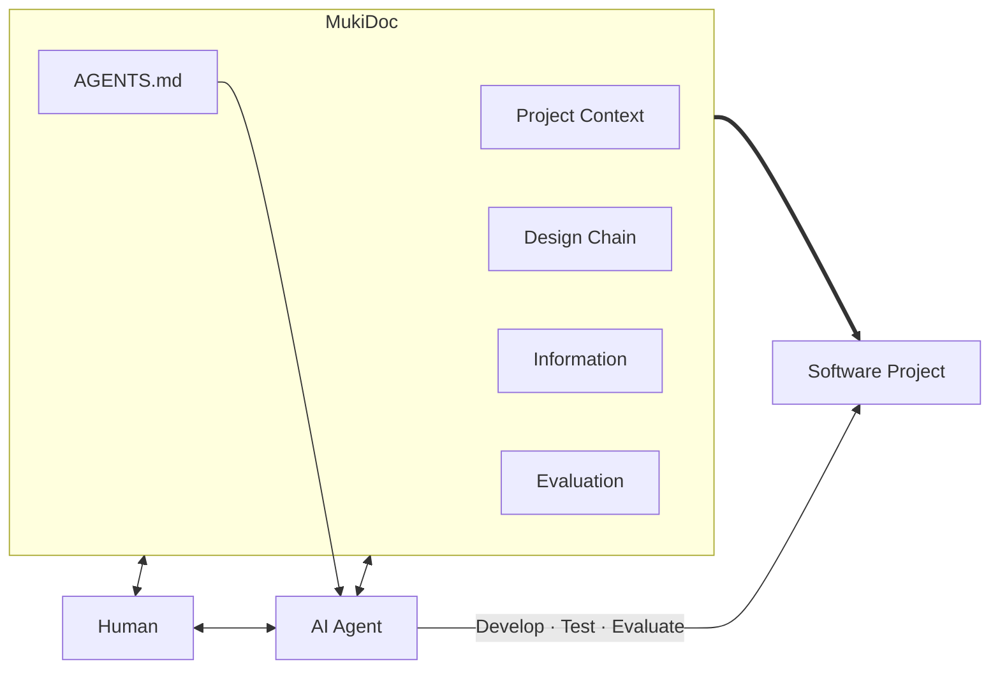
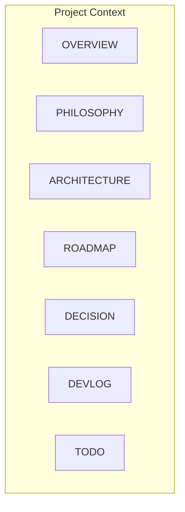
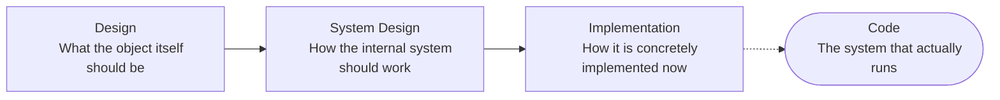
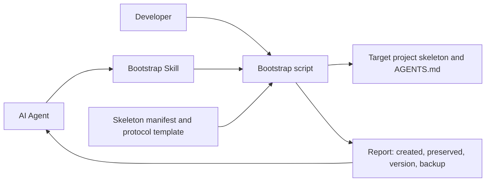
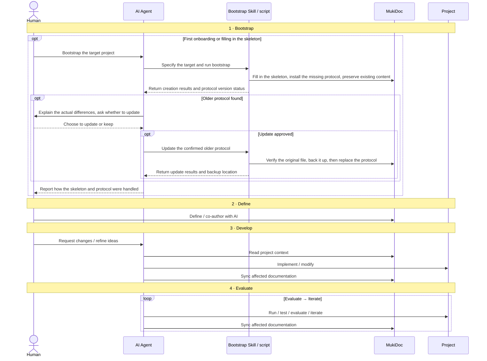

# Architecture

## Overall Architecture

MukiDoc sits between the Human, the AI Agent and the actual software project, and holds the context that must persist over the long term during development. The Human and the AI maintain MukiDoc together; the AI develops, tests and evaluates the actual project based on this context, and keeps the documents in sync throughout.



## Project Context

Project Context holds the authoritative description of the project itself: what the project is, why it is done this way, how it is composed internally, and what state it is in now. Information and Evaluation sit alongside it and do not belong to it. The former is the materials and evidence on which these descriptions rest; the latter judges the commitments made in these descriptions.



These documents maintain the same authoritative description from different angles, so that a new developer or AI can first build an overall understanding and then move into concrete design and implementation.

## Core Design Chain

The core design chain consists of three layers that refine successively and are decoupled from each other.



The upper layer defines the semantics and constraints that must be preserved, and the lower layer further decides how to implement them. The same Design can correspond to different System Designs, and the same System Design can correspond to different Implementations.

## Bootstrap

The bootstrap Skill hands the target directory and the user's protocol-update choice to a script, and the script fills in the skeleton from a versioned resource bundle. A human can also run the same script directly; the target project does not need access to MukiDoc's source specification.



Bootstrap preserves existing files by default; an older protocol is updated only after the user explicitly chooses to, by backing it up first and then replacing it. The root AGENTS.md enters the Skill's standalone resource bundle through an exporter; at runtime the Skill uses the version shipped in the bundle and does not look up the latest version online.

## Runtime

From the moment a project is onboarded, a complete process has four stages: Bootstrap, Define, Develop and Evaluate. Bootstrap establishes the fixed skeleton and handles the protocol version; the Human then forms the documents together with the AI, the AI completes the implementation from the project context and syncs the documents, and the actual running results drive continued iteration. Day-to-day development on an existing project can go straight to the later stages, without re-bootstrapping each time.



Bootstrap only establishes structure and does not fill in project facts; keeping an older protocol does not prevent the skeleton from being filled in. The diagram above shows the Skill entry point and an older-version update as the typical process; a developer can also run the script directly, and the handling of unversioned, same-version-modified and newer-version protocols follows Bootstrap's version rules. In day-to-day development, the human mainly states requirements, forms judgments, and checks whether the project still matches the intent; the AI reads the context, refines downward, completes the implementation, and keeps the affected documents in sync.

## Architecture Tree

1. Human
    1. States requirements, makes judgments and sets direction; may also take part in writing documents directly.
    2. Understands and controls the project mainly through MukiDoc, without needing to remember code details over the long term.
2. AI Agent
    1. Refines designs, completes development, testing and evaluation, and updates the related documents in sync.
    2. AGENTS.md is maintained by MukiDoc and gives the Agent fixed working rules.
3. MukiDoc
    1. Project Context
        1. README: the project entry point.
        2. OVERVIEW: what the project is.
        3. PHILOSOPHY: why it is done this way.
        4. ARCHITECTURE: how the system as a whole is composed.
        5. ROADMAP: how the project develops over the long term.
        6. DECISION: how important decisions were reached.
        7. DEVLOG: what actually happened during development.
        8. TODO: where we are now and what to do next.
    2. Design Chain
        1. Design: what the thing itself should be like.
        2. System Design: how the internal system should work.
            1. Cross-Area concerns go at the layer root; optional: DATA_MODEL.md, RUNTIME.md.
        3. Implementation: how it is concretely implemented now.
            1. Cross-Area concerns go at the layer root; optional: TECH_STACK.md, API.md.
        4. The three layers are fixed vertically, and within each layer documents are organized horizontally by Area; Areas form naturally from the project, grow on demand, and need not be mirrored across layers.
    3. Information
        1. Raw Materials: the original context that helps explain a project's origins, such as early discussions, original requirements and historical material.
        2. External Information: external material, usually excerpts from the original, copied and tidied text, or AI research summaries.
        3. Investigations: the process, key findings and conclusions of investigating real problems.
        4. Playground: exploratory experiments, and loose thoughts not yet in any formal category.
    4. Evaluation
        1. Defines the evaluation dimensions the project cares about and hands them to programs or Agents for automatic evaluation.
        2. Evaluation results drive later iteration and reveal in time whether the project has drifted from its goals.
    5. Bootstrap
        1. Skill: the bootstrap entry point and protocol-update choice.
        2. Bootstrap script: checks paths, builds the skeleton, preserves content, and backs up before replacing.
        3. Resource bundle: version, fixed manifest, skeleton documents and the full protocol.
        4. Exporter and tests: sync the authoritative protocol and verify delivery behavior.


## File Structure

Base directories and skeleton documents are always created and kept, even when temporarily empty. The root README.md and AGENTS.md and the seven Project Context documents under mukidoc are fixed files; the three design-chain layers, Information's four category directories and Evaluation's four commitment-source directories are fixed entry points. Areas, concrete design documents and files marked optional are created on demand. MukiCheck is not yet built and is not part of the current bootstrap requirements.

```text
/
├── README.md
├── AGENTS.md
│
├── mukidoc/
│   ├── OVERVIEW.md
│   ├── PHILOSOPHY.md
│   ├── ARCHITECTURE.md
│   ├── ROADMAP.md
│   ├── DECISION.md
│   ├── DEVLOG.md
│   ├── TODO.md
│   │
│   ├── information/
│   │   ├── raw_materials/
│   │   ├── external_information/
│   │   ├── investigations/
│   │   └── playground/
│   │       └── ...
│   │
│   ├── design/
│   │   ├── <area>/            # Organized by Area; grows on demand, not mirrored
│   │   │   └── ...
│   │   └── ...
│   │
│   ├── system_design/
│   │   ├── DATA_MODEL.md      # Cross-Area concern at the layer root; optional
│   │   ├── RUNTIME.md         # optional
│   │   ├── <area>/
│   │   └── ...
│   │
│   ├── implementation/
│   │   ├── TECH_STACK.md      # optional
│   │   ├── API.md             # optional
│   │   ├── <area>/
│   │   └── ...
│   │
│   └── evaluation/
│       ├── philosophy/
│       ├── design/
│       ├── system_design/
│       ├── implementation/
│       └── mukicheck/         # Planned location; not required at bootstrap yet
│
├── skills/
│   └── mukidoc-init/
│       ├── SKILL.md
│       ├── agents/openai.yaml
│       ├── scripts/init_mukidoc.py
│       └── assets/
│           ├── manifest.json
│           └── template/
├── scripts/
│   └── sync_skill_assets.py
├── tests/
│   └── test_bootstrap.py
│
└── ...
```
